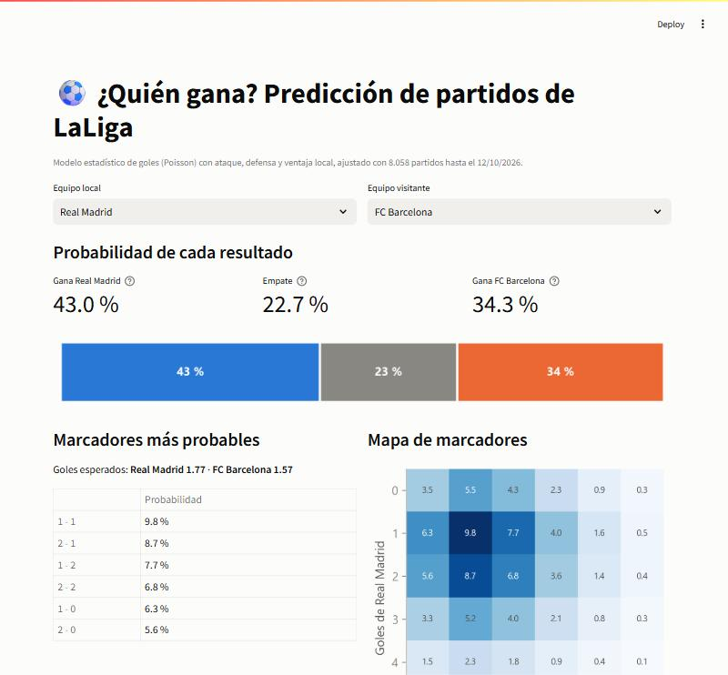
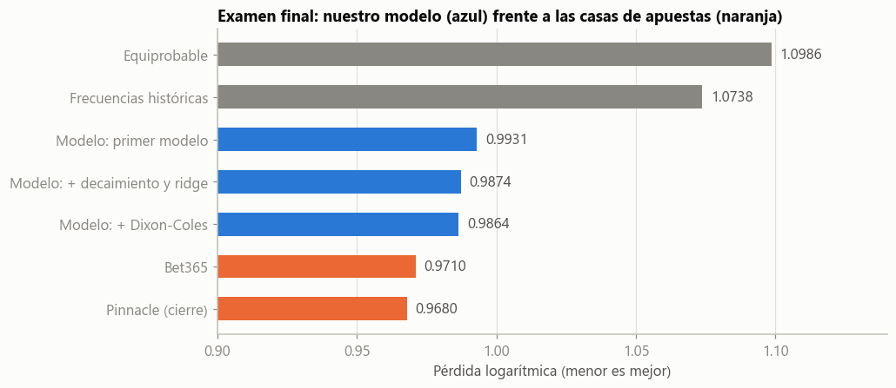
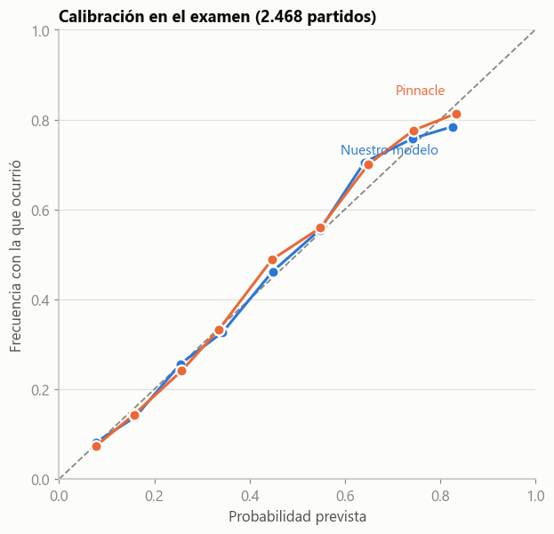

# ⚽ Predicción de partidos de LaLiga con un modelo de goles

Modelo estadístico que estima, antes de cada partido de LaLiga, la probabilidad de **victoria local, empate y victoria visitante**, usando solo los resultados pasados. Se evalúa sin "mirar el futuro" y se compara con las **cuotas de las casas de apuestas** como vara de medir. Incluye una **app interactiva** (Streamlit).

<p align="center">
  
</p>

## Resultados

Examen final sobre **2.468 partidos (temporadas 2019/20 en adelante)** que no se usaron para diseñar ni elegir nada. La métrica es la pérdida logarítmica (*log loss*): menor es mejor.

| Predictor | Pérdida | Hueco cerrado\* |
|---|---|---|
| Frecuencias históricas (siempre las mismas probabilidades) | 1,0738 | 0 % |
| **Este modelo (solo resultados pasados)** | **0,9874** | **82 %** |
| Bet365 (cuotas antes del partido) | 0,9710 | 97 % |
| Pinnacle (cuotas de cierre) | 0,9680 | 100 % |

\* Fracción de la distancia entre "frecuencias históricas" y Pinnacle que consigue cerrar el modelo.

<p align="center">
  
  
</p>

* El modelo, que solo conoce los goles pasados, queda **un poco por detrás de las casas** (que conocen lesiones, alineaciones y el dinero apostado), siempre entre 0,010 y 0,027 en las siete temporadas del examen.
* Sus probabilidades están **bien calibradas**: cuando dice un 25 %, ocurre un 25,6 %.

## Cómo funciona

1. **Goles de Poisson.** Los goles de cada equipo en un partido siguen una distribución de Poisson cuya media depende del **ataque** del equipo, la **defensa** del rival y la **ventaja de jugar en casa**. Los parámetros de cada uno de los 41 equipos se ajustan por máxima verosimilitud.
2. **De goles a probabilidades.** Con los goles esperados de cada equipo se calcula la probabilidad de cada marcador y, sumándolas, la de victoria local, empate y victoria visitante.
3. **Memoria y regularización.** Los partidos antiguos pesan menos (la mitad cada año) y los parámetros se encogen hacia la media (*ridge*) para que un equipo con pocos partidos no tenga valores extremos. Ambos se eligen con un periodo de ajuste (2012/13-2018/19).
4. **Validación temporal (*walk-forward*).** Cada semana se reajusta el modelo solo con los partidos ya jugados y se predicen los de esa semana. Nunca se usa información del futuro, y el examen final no interviene en ninguna decisión.

## Qué se probó y no funcionó

* **Corrección de Dixon-Coles** para marcadores bajos: no mejoraba en el periodo de ajuste (ρ ≈ −0,014), así que no se usa.
* **Entrenar con tiros en lugar de goles** (los tiros son menos ruidosos): empeora la predicción. La causa es que la **puntería** de un equipo es una cualidad persistente (correlación 0,42 entre temporadas) y los goles ya la incorporan; los tiros la ignoran. Combinar ambos modelos tampoco ayuda. Detalle en el cuaderno 03.

## Estructura

```
├── notebooks/
│   ├── 01_exploracion.ipynb              Datos, ventaja local, ¿son Poisson los goles?, cuotas y calibración, la vara de medir
│   ├── 02_modelo.ipynb                   El modelo, validación temporal, elección de hiperparámetros y examen final
│   └── 03_tiros_y_calibracion.ipynb      ¿Mejoran los tiros al modelo? (no) y calibración del modelo final
├── src/
│   ├── futbol.py                         Carga y limpieza de datos, cuotas a probabilidades, estilo de gráficas
│   └── modelo.py                         Modelo de Poisson, ajuste, walk-forward, métricas
├── scripts/
│   ├── descargar_datos.py                Descarga los CSV de LaLiga de football-data.co.uk
│   └── exportar_modelo.py                Ajusta el modelo con todos los datos y guarda sus parámetros para la app
├── app/
│   ├── app.py                            App de Streamlit
│   └── modelo_actual.json                Parámetros del modelo (ataque, defensa y ventaja de cada equipo)
└── docs/figures/                         Imágenes del README
```

## Cómo ejecutarlo

Requiere Python ≥ 3.10.

```bash
pip install -r requirements.txt
streamlit run app/app.py                  # la app funciona directamente con los parámetros guardados
```

Para reproducir los cuadernos hay que descargar antes los datos (no se incluyen en el repositorio, ver más abajo):

```bash
python scripts/descargar_datos.py         # CSV de LaLiga 2005/06 hasta hoy -> data/raw/
jupyter lab notebooks/
python scripts/exportar_modelo.py         # opcional: actualiza la app con los últimos partidos
```

## Datos

Resultados y cuotas de LaLiga de [football-data.co.uk](https://www.football-data.co.uk) (temporadas 2005/06 a 2026/27, 22 CSV). El sitio ofrece los datos gratis para uso privado y de predicción de partidos, y no indica una licencia de redistribución, por lo que **este repositorio no incluye los CSV**: el script de descarga los obtiene directamente de su web. La app solo usa los parámetros ajustados, no los datos originales.

## Limitaciones

* El modelo solo usa los **goles pasados**: no conoce lesiones, alineaciones, sanciones, calendario ni descansos.
* Los equipos recién ascendidos empiezan con un nivel "medio".
* La ventaja local es igual para todos los equipos.
* Proyecto educativo; **no es una recomendación de apuestas**.

## Lo que muestra este proyecto

* Modelado estadístico (regresión de Poisson por máxima verosimilitud, con gradiente analítico verificado numéricamente), con decaimiento temporal y regularización.
* **Evaluación honesta**: validación temporal, separación entre periodo de ajuste y examen final, y comparación con una referencia externa de alto nivel (el mercado de apuestas).
* Pensamiento crítico: hipótesis que no se cumplen (tiros, Dixon-Coles) diagnosticadas y documentadas.
* Python científico (`NumPy`, `SciPy`, `pandas`, `Matplotlib`), diseño de gráficas y una app con `Streamlit`.

## Licencia

El código se publica bajo licencia MIT (ver [`LICENSE`](LICENSE)).
